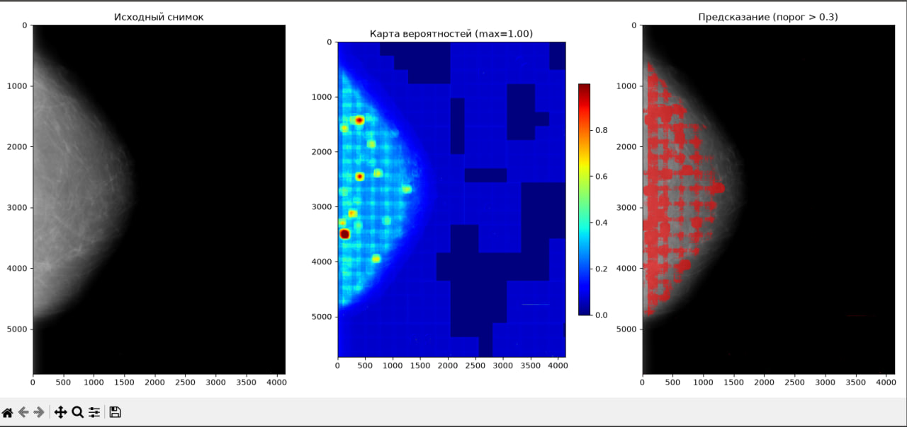
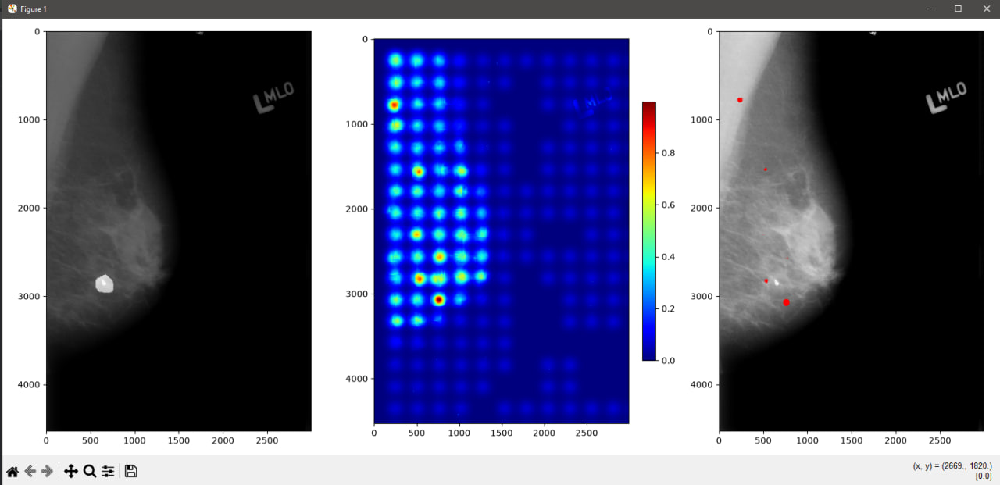
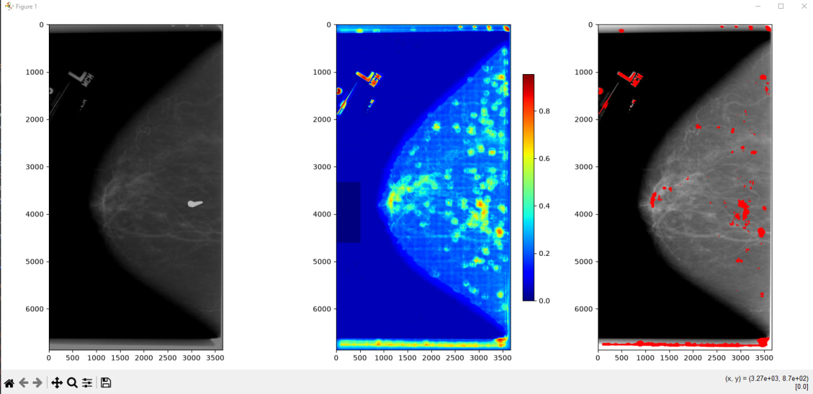
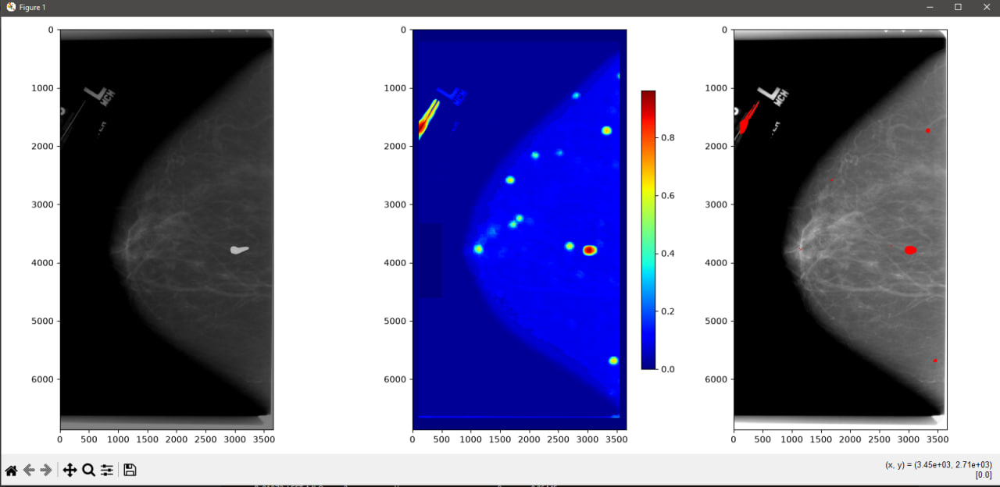
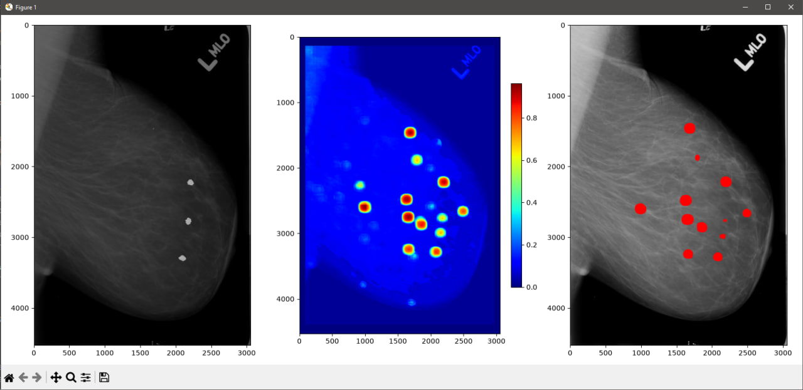
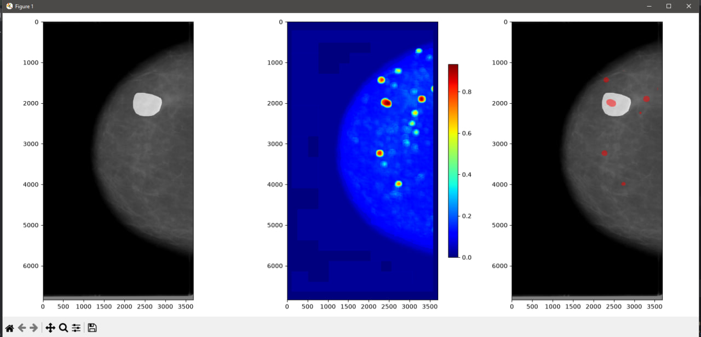

# Диплом по ML
## "Разработка хранилища медицинских изображений на базе S3 и нейросетевой модели для выделения областей поражения на маммограммах"

Данные в DICOM  
Ссылка на данные [CBIS-DDSM | Curated Breast Imaging Subset of Digital Database for Screening Mammography](https://www.cancerimagingarchive.net/collection/cbis-ddsm/)  
Получить можно через устнавку [TCIA Data Retriever](https://wiki.cancerimagingarchive.net/display/NBIA/Downloading+TCIA+Images)

Первое обучение 

Второе обучение 

Третье обучение 

### Архитектура 

**Хранилище (Data Lake)**  
MinIO - S3 (coollabsio/minio)

**T**  
Pandas + Pydicom (для DICOM)

**ML-слой**  
для обуч и cnn PyTorch  
U-Net - сегментация   

**Веб-интерфейс и Бэкенд**  
FastApi + SQLAlchemy + Pydantic  
Postgrsql   
React

cnn, relu, batch norm, Max Pool, ConvTranspose2d